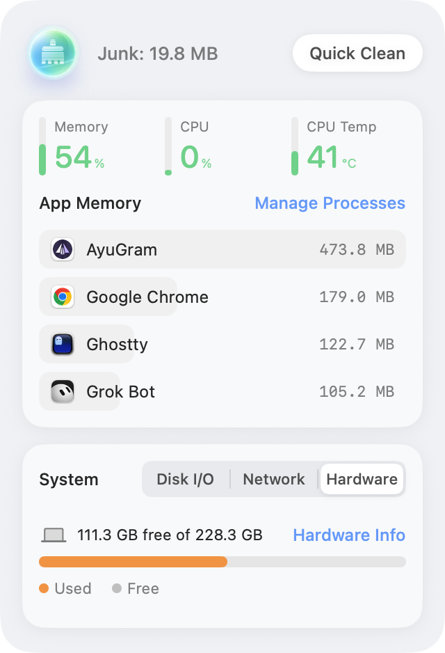
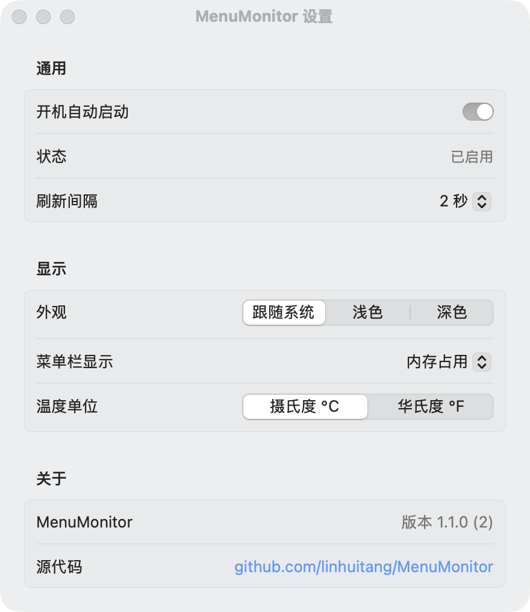

# MenuMonitor

macOS 菜单栏系统监控小工具（原生 SwiftUI / AppKit）。

> A lightweight macOS menu-bar system monitor built with SwiftUI and AppKit.



## 功能

- **菜单栏**：实时显示内存占用百分比
- **弹出面板**
  - 待清理缓存估算与「快速清理」（清理 `~/Library/Caches`，无二次确认，带进度）
  - 内存 / CPU / CPU 温度
  - 应用内存占用 Top 10（可结束进程、查看详情）
  - 磁盘空间、网络与磁盘 I/O 速率
  - 「管理进程」打开「活动监视器」；「硬件详情」打开「系统信息」
- **深色模式**：面板跟随系统外观，也可在设置中固定为浅色 / 深色
- **设置**（右键菜单栏图标 →「设置…」，⌘,）
  - 开机自动启动
  - 外观：跟随系统 / 浅色 / 深色
  - 刷新间隔：1 / 2 / 5 秒
  - 菜单栏显示：内存 / CPU / 内存 + CPU / 仅图标
  - 温度单位：°C / °F
- **退出**：右键菜单栏图标 →「退出 MenuMonitor」（左键打开/关闭面板）



## 环境要求

- **macOS 14+**（见 `Package.swift`）
- Apple Silicon 或 Intel（CPU 温度优先通过 IOKit HID 传感器读取，读不到时显示 `--`）
- 仅需 **Command Line Tools**（`xcode-select --install`），不必安装完整 Xcode

## 编译与安装

```bash
git clone https://github.com/linhuitang/MenuMonitor.git
cd MenuMonitor
./build.sh
```

`build.sh` 会：`swift build -c release` → 在临时目录组装 `MenuMonitor.app` → ad-hoc 签名 → 退出旧进程并安装到 `/Applications` → 启动（项目目录不会留下第二份 App）。

仅编译：

```bash
swift build -c release
```

## 退出

- 右键菜单栏图标 → **退出 MenuMonitor**
- 或终端：`pkill -x MenuMonitor`

## 首次打开（未公证）

本项目以 **ad-hoc 签名**分发，**未经 Apple 公证**。从 GitHub Release 下载 DMG/ZIP 后，若系统提示无法打开：

1. 将 `MenuMonitor.app` 拖到「应用程序」
2. **右键** App → **打开**（不要双击），在对话框中再点「打开」
3. 或在终端移除隔离属性后启动：

```bash
xattr -dr com.apple.quarantine /Applications/MenuMonitor.app
open /Applications/MenuMonitor.app
```

也可在「系统设置 → 隐私与安全性」中允许仍被拦截的 App。

## 说明

- 「快速清理」只删除用户 `~/Library/Caches` 下可安全清理的内容，不会动废纸篓或其他目录
- 待清理体积低于 1 MiB 时显示「没有要清理的垃圾」，并禁用快速清理按钮

## 许可证

MIT © 2026 linhuitang
